<!-- leleure // animated profile — custom SVGs, hacker theme (black/grey/white hat) -->

  

<h3><code>leleure@github ~ $ ./whoami.sh</code></h3>

  

<h3><code>leleure@github ~ $ ./tryhackme.sh</code></h3>

  

<h3><code>leleure@github ~ $ cat ./contributions.sh</code></h3>

<picture>
  <source media="(prefers-color-scheme: dark)" srcset="https://raw.githubusercontent.com/leleure/leleure/output/snake-dark.svg" />
  <source media="(prefers-color-scheme: light)" srcset="https://raw.githubusercontent.com/leleure/leleure/output/snake.svg" />
  
</picture>

  

<code>// connection closed by remote host</code>

